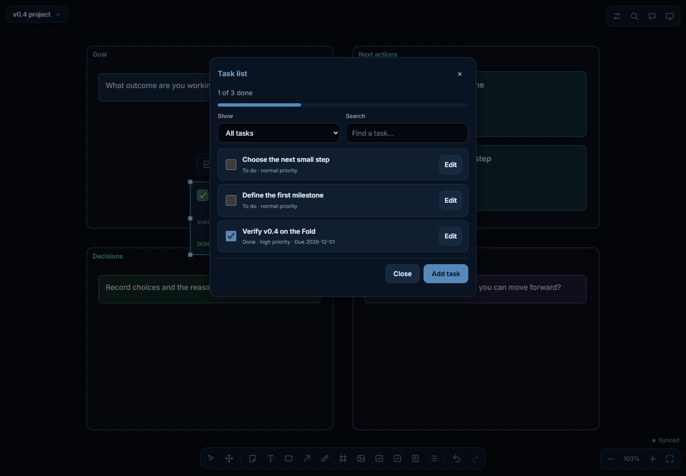

# O Board

A private thinking space on your TV. You talk to your phone, and an assistant (Google Gemini) puts your ideas on a big
shared canvas: notes, diagrams, arrows, sections, photos. Everything lives on a Raspberry Pi at home. The TV shows the
board, and the phone captures, edits and talks.

```
 Galaxy Z Fold 7 (Android app)                Raspberry Pi 5 (server)                     TV (HDMI)
 ┌──────────────────────────────┐   Wi-Fi /   ┌───────────────────────────────┐  local  ┌──────────────────┐
 │ hold-to-talk, on-device       │  Tailscale  │ boards in SQLite, op log,     │  HTTP   │ full-screen board │
 │ speech (Qwen3-ASR) and voice  │ ──────────▶ │ undo, backups                 │ ──────▶ │ (Chromium kiosk,  │
 │ (Kokoro / Supertonic)         │  HTTP + WS  │ WebSocket live sync           │         │  auto-starts)     │
 │ canvas (same web UI as TV)    │ ◀────────── │ Gemini agent with 34 canvas   │         └──────────────────┘
 │ remote control for the TV     │             │ tools; the API key lives only │
 └──────────────────────────────┘             │ here                          │ ───▶ Gemini API (internet)
                                              └───────────────────────────────┘
```

## What you get

**New in v0.4:**
- **Setup & diagnostics:** add your Gemini key from the phone; check the Pi, TV, storage, backups, microphone permission and voice model downloads. Test whether Google accepts the key and lists your selected models.
- **Task cards:** titles, details, To do / In progress / Done, priorities and optional due dates. Tap the checkbox, edit from the selection menu, or ask the assistant. **Task list** shows progress, search and status/overdue filters. Tasks sync and undo like notes.
- **Board templates:** blank, project planner, brainstorm, decision comparison, weekly plan and research. Every starter card and section is editable.
- **Project memory:** a lasting goal, decisions, open questions and next steps per board. Open it from the canvas toolbar or **More → Project memory**. It is included in each assistant turn and in backups and board exports. When devices edit together, independent changes merge and conflicting fields let you choose which version to keep.



- **TV board.** Turn on the TV and your workspace is there. The assistant's changes glide into view as they happen.
- **Phone app.** Built for the Fold 7: one column on the cover screen, side-by-side panes unfolded.
  - **Capture:** type or hold the mic. **Save** files a thought in *Thoughts* (works offline and syncs later). **Ask**
    sends it to the assistant.
  - **Boards:** your Thoughts inbox and project spaces.
  - **Canvas:** move and edit things yourself with touch.
  - **TV remote:** pan, zoom and focus the TV from the phone.
- **Voice that stays on the phone.**
  - Speech recognition (Qwen3-ASR 0.6B) and the voice (Kokoro 82M, or Supertonic for speed) run on the device. Only
    text goes to Gemini.
  - Replies start speaking after the first sentence, and you can cut them off instantly.
  - Hands-free mode uses voice detection.
  - Optional **Gemini Live** mode gives cloud native-audio conversation.
- **An assistant that really edits the board.**
  - Notes, diagrams with labelled arrows, sections, tidying, search, recall of older thoughts, focusing the TV, and
    reading photos.
  - Every AI change is one undoable step, and destructive changes ask first. You can say "go back to the earlier
    version" or "don't save that".
- **Live widgets.** Say "track NVDA", or use **Add widget** on the board.
  - Six tested ready-made widgets: a stock ticker with a chart, crypto, weather with a 5-day forecast, a world clock,
    a countdown and a shared timer. They need no keys.
  - For anything else, the assistant writes the widget itself, such as a habit tracker or a different data source.
  - Each widget runs sealed off on the TV and phone, with a chart library built in.
  - The assistant sees whether its widget worked and fixes its own mistakes.
  - If a service needs an API key, a card appears in the app. The key is stored only on the Pi, is sent only to that
    service's website, and is never shown to Gemini.
- **Works away from home.** With Tailscale, the phone switches to the Pi's Tailscale address by itself when you leave
  home, and switches back when you return.

## Set it up

1. **Raspberry Pi.** Flash Raspberry Pi OS (64-bit), copy this folder over, then run `sudo ./pi/install.sh`.
   Step by step: [pi/README.md](pi/README.md).
2. **Phone.** Install `OBoard-<version>-arm64.apk` and open it. It finds the Pi on your Wi-Fi; enter the 8-digit code
   the TV shows (or open the TV's QR code).
3. **Voice.** In the app, go to Settings → Voice models → Download (about 1.3 GB; use Wi-Fi). Until then you can type,
   and Gemini Live works without the download.
4. **Away from home** (optional). Install Tailscale on the Pi and the phone. That's all. See
   [pi/README.md](pi/README.md#use-it-away-from-home).

You need a Gemini API key from [Google AI Studio](https://aistudio.google.com/apikey). Enter it during installation,
or leave it blank and add it after pairing in **Settings → Setup & diagnostics**. The key is stored only on the Pi.

## What has been verified

This was built and tested without a physical Fold 7, without a Raspberry Pi, and without a real Gemini key. The full,
honest list is in [docs/TEST-REPORT.md](docs/TEST-REPORT.md).

**Verified:**
- 73 automated server tests, including v0.3 database migration, task sync/undo, templates, memory conflict recovery and credential isolation.
- The Android app on an emulator (debug and signed release builds), including the unfolded Fold 7 size.
- On-device speech recognition and voice, with measured speed.
- Interrupting speech.
- Touch editing on the canvas.
- Network failover.
- The Live and agent flows end to end, against a local stand-in for Gemini.
- Live widgets in real Chrome and the Android WebView, with real data, including all six ready-made widgets and the
  API-key protections.

**Not yet tested:**
- Real Gemini responses.
- The install script on real Pi hardware.
- Audio quality through a real microphone and speaker.
- Installing on an actual Fold 7.

## Documentation

| | |
|---|---|
| [pi/README.md](pi/README.md) | Installing the Pi, the TV kiosk, pairing, Tailscale, backups, troubleshooting |
| [docs/ARCHITECTURE.md](docs/ARCHITECTURE.md) | How the pieces fit: data model, sync protocol, AI agent, voice pipeline |
| [docs/VOICE.md](docs/VOICE.md) | Speech model research, benchmarks and the choices made (incl. Qwen3-TTS) |
| [docs/SECURITY.md](docs/SECURITY.md) | Where the key lives, pairing, tokens, network exposure |
| [docs/TEST-REPORT.md](docs/TEST-REPORT.md) | Acceptance tests A–I: what ran, results, what is still unverified |
| [docs/RELEASE-0.4.0.md](docs/RELEASE-0.4.0.md) | What's new in v0.4, fixes and upgrade instructions |

## Development

The repository is organised like this:

```
server/    Node 24 server: HTTP + WebSocket, SQLite (node:sqlite), Gemini agent. One dependency (ws).
web/       The canvas UI (no build step). Served to the TV and browsers; bundled into the APK.
android/   Kotlin + Jetpack Compose app.
pi/        Installer, systemd units, kiosk, health check, backup/restore.
tools/     Dev-only: a fake Gemini for tests (mock-gemini.mjs), voice benchmark scripts.
scripts/   Packaging (package.mjs) and release-key creation (make-keystore.ps1).
```

**Server:**

```bash
cd server && npm install && npm test
```

To run it locally, create `server/.env` (gitignored) with `PORT`, `DATA_DIR` and `GEMINI_API_KEY`, then run
`npm start`. Open `http://localhost:8080/?mode=tv` for the TV view.

To work without a key, run `node tools/mock-gemini.mjs` and set `GEMINI_BASE_URL=http://127.0.0.1:8099`.

**Android** (JDK 17+; Android Studio's `jbr` works):

```bash
cd android && ./gradlew assembleDebug -Pabis=arm64-v8a,x86_64
```

- `x86_64` is only for the emulator. The release build is arm64 only.
- The first build downloads the sherpa-onnx speech library (50 MB) and checks its SHA-256.
- For a signed release, run `scripts/make-keystore.ps1` once, then `./gradlew assembleRelease`.
- Back up `android/oboard-release.jks` and `android/keystore.properties`. Updates must be signed with the same key.

**Pi bundle:**

```bash
node scripts/package.mjs
```

This writes `dist/oboard-pi-<version>.tar.gz`, which contains the server, the web UI and the Pi scripts.

## Licences

O Board's own code has no licence file yet. Third-party components and models, all used under their own licences:
- sherpa-onnx (Apache-2.0)
- Qwen3-ASR (Apache-2.0)
- Kokoro (Apache-2.0)
- Supertonic (OpenRAIL-M)
- Silero VAD (MIT)
- espeak-ng data (GPL-3.0, used as data)
- Inter font (OFL)
- ws (MIT)

The app lists them under Settings → About.
